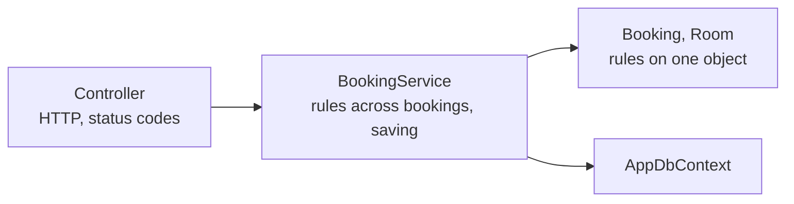
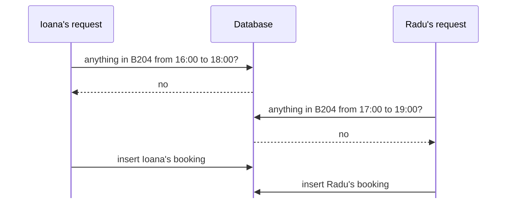
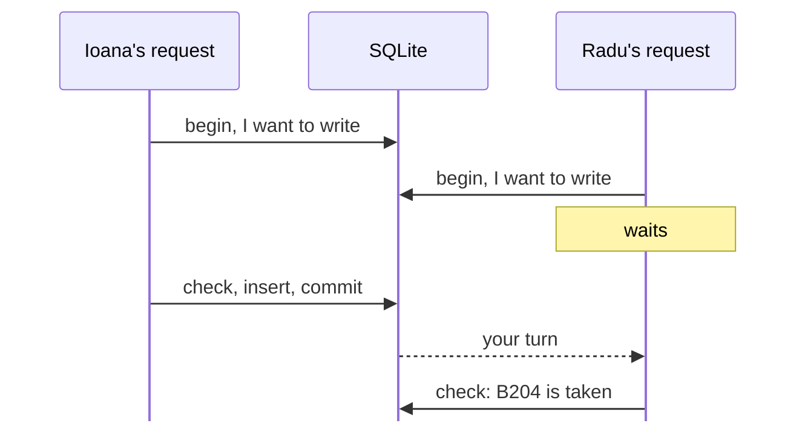

# Optional: A database, and two requests at once

Optional and not graded. Feel free to leave.

---

# Where we left off

Last week's API checks every rule, but it keeps the bookings in a `List` in memory. Two things go wrong because of that:

- Stop the API and start it again, and every booking is gone.
- Two requests that arrive at the same moment can both book the same room.

Today the data moves to a database, and then we look closely at the second problem. Accounts come next week.

<AppLink tag="week-05" compare="week-04" />

<!--
The link shows every change since last week. It works once week-05 is tagged after the lab.
-->

---

# SQLite

A database is a program that keeps data on disk and answers questions about it. Most databases, such as PostgreSQL or SQL Server, run as a separate server that the application connects to.

SQLite is a library that runs inside our program. The whole database is one file, `study-rooms.db`, next to the code, and there is nothing to install. Phones, browsers and many desktop programs keep their data in SQLite.

<!--
After the first run, open study-rooms.db with a viewer: the SQLite Viewer extension in VS Code, or the Database tool window in Rider. Show the four tables and the rows.
-->

---

# Tables, rows and columns

```text
Rooms
  Id   Name   Building                 Capacity   Equipment   IsActive
  1    A101   Library                  3          2           1
  2    A102   Library                  6          10          1
  3    B204   Electrical Engineering   10         13          1
```

A table is like a `List<Room>`: one row for each object, one column for each property. You ask the database questions in SQL:

```sql
SELECT Name, Capacity FROM Rooms WHERE Capacity >= 5;
```

<!--
Equipment is the [Flags] enum, stored as one number: 2 is Whiteboard, 10 is Whiteboard + PowerOutlets (2 + 8), 13 is Projector + Tv + PowerOutlets (1 + 4 + 8). IsActive is a bool; SQLite stores it as 0 or 1.
-->

---

# EF Core

We will not write SQL by hand. EF Core (Entity Framework Core) is a library that maps our classes to tables. It writes the SQL, runs it, and turns the rows it gets back into objects.


It comes from two NuGet packages: `Microsoft.EntityFrameworkCore.Sqlite` for the database, and `Microsoft.EntityFrameworkCore.Design` for the migrations we will see in a few slides.

---

# The context

```cs
public class AppDbContext : DbContext
{
    public AppDbContext(DbContextOptions<AppDbContext> options) : base(options)
    {
    }

    public DbSet<Room> Rooms => Set<Room>();
    public DbSet<Booking> Bookings => Set<Booking>();
    public DbSet<Participant> Participants => Set<Participant>();
    public DbSet<User> Users => Set<User>();
}
```

There is one `DbSet` for each table. `_db.Rooms.Add(room)` and `_db.Bookings.Where(...)` look like the lists we had, and they work on the database.

<!--
: base(options) passes the options on to the constructor of DbContext, the base class (lab 4). The options say which database to open, and they come from Program.cs, next slide.
-->

---

# Registering the context

```cs
builder.Services.AddDbContext<AppDbContext>(options =>
    options.UseSqlite(builder.Configuration.GetConnectionString("StudyRooms")));
```

```json
"ConnectionStrings": {
  "StudyRooms": "Data Source=study-rooms.db"
}
```

A connection string tells EF Core which database to open. For SQLite it is a file name. For a database server it holds an address, a user name and a password.

`options => ...` is a lambda, like the ones in today's lab. `AddDbContext` calls it once to set up the options.

---

# What EF Core needs from our classes

Every property that is stored needs a setter. `{ get; }` becomes `{ get; private set; }`, so code outside the class still cannot change it.

The database picks the ids. Constructors stop taking an id, and the `_nextBookingId` counters are gone. After a booking is saved, `booking.Id` has the value the database chose.

```cs
public int Id { get; private set; }    // set by the database on the first save
```

Properties without a setter, such as `StartsAt`, are computed from the others and stay out of the table.

---

# A constructor for EF Core

```cs
public Booking(int roomId, string ownerId, DateOnly date, ...)
{
    ...
    Participants.Add(new Participant(ownerId, ParticipantStatus.Joined));
}

// EF Core uses this constructor when it reads a booking from the database.
private Booking()
{
    OwnerId = "";
}
```

To read a row, EF Core first has to create an object. It can call a constructor whose parameters have the same names as the properties, and it does that for `Room`. The `Booking` constructor also adds the owner as a participant, who is already in the `Participants` table, so the owner would appear twice. The private constructor gives EF Core a way in that our own code cannot use.

<!--
EF Core picks the constructor with the fewest parameters it can fill, so it takes the private one. OwnerId = "" keeps the compiler quiet about a non-nullable string; EF Core sets the real value right after.
-->

---
layout: two-cols
---

# Keys and indexes

```cs
[PrimaryKey(nameof(BookingId), nameof(UserId))]
public class Participant
{
    public int BookingId { get; private set; }
    public string UserId { get; private set; }
    ...
}

[Index(nameof(Name), IsUnique = true)]
public class Room { ... }
```

::right::

<div class="pl-6 pt-22">

A key picks out one row. EF Core makes a property called `Id` the key without being told, so `Room`, `Booking` and `User` need nothing extra. An `int` key is numbered by the database (1, 2, 3), while `User.Id` is a `string` such as `"ana"` that we choose.

`Participant` has no `Id`. Its key is the booking and the student together, so the database refuses a second row for the same student in the same booking. A unique index does the same for one column: two rooms cannot both be called A101.

</div>

<!--
These attributes come from EF Core, like [ApiController] comes from ASP.NET Core.
[Key] on a property says the same thing explicitly; a property named after the class, such as BookingId in Booking, would also become the key. In the migration: table.PrimaryKey("PK_Bookings", x => x.Id), and .Annotation("Sqlite:Autoincrement", true) on the int ids.
BookingId is also a foreign key: each row of Participants points to a row of Bookings. EF Core finds it from the List<Participant> in Booking. More relationships next week.
-->

---

# Migrations

```bash
dotnet tool restore
dotnet ef migrations add Initial --project src/StudyRooms.Api
```

EF Core compares our classes with the last migration and writes a C# file with the difference: create the table `Rooms` with these columns, and so on. Every later change to a stored class, such as a new property, is a new migration, so a database made last week can catch up one step at a time.

```cs
db.Database.Migrate();    // in Program.cs: run the migrations that are missing
```

<!--
Open Migrations/..._Initial.cs: CreateTable for each table, the key with two columns, the foreign key, the unique index.
The table __EFMigrationsHistory in the database lists the migrations that already ran.
dotnet-tools.json in the repository lists dotnet-ef, so dotnet tool restore installs the same version for everyone.
-->

---

# Who creates the objects?

Since week 3 our controllers ask for things in their constructor, and ASP.NET Core creates them. When we register a class, we also say how long one object of it lives.

| Registration | One object for | In our API |
|---|---|---|
| `AddSingleton` | the whole application | `BookingRules`, which only reads settings |
| `AddScoped` | one request | `AppDbContext`, `BookingService`, `RoomService` |
| `AddTransient` | each constructor that asks for it | small helpers that keep nothing |

<!--
Ties to lecture 5 (binding, scope, lifetime). A local variable lives while its method runs; a scoped service lives while its request runs.
AddDbContext registers the context as scoped.
-->

---

# Why the context is scoped

`AppDbContext` remembers every object it has read or added, so that it can save the changes later. ASP.NET Core creates a new one for each request and disposes it when the response has been sent, so every request starts with an empty memory.

One context must never be used by two requests at the same time. EF Core throws an exception when it notices.

---

# The singleton becomes scoped

```cs
// Weeks 3 and 4: one Timetable for everyone, holding the lists.
builder.Services.AddSingleton<Timetable>();

// Week 5: a new BookingService for each request, with that request's AppDbContext.
builder.Services.AddScoped<BookingService>();
builder.Services.AddScoped<RoomService>();
```

The data is in the database now, so the service can be new for every request. The controllers barely change: they still get the service through the constructor.

<!--
A singleton cannot take a scoped service in its constructor: one object for the whole application would keep one request's context forever. ASP.NET Core refuses to start if you try. We meet this again in week 9, with a background service.
-->

---

# At startup there is no request

```cs
using (IServiceScope scope = app.Services.CreateScope())
{
    AppDbContext db = scope.ServiceProvider.GetRequiredService<AppDbContext>();
    db.Database.Migrate();
    if (db.Rooms.Count() == 0)
    {
        AddSampleData(db);
    }
}
```

ASP.NET Core makes a scope for every request. Before the first request we need a context too, so we make a scope ourselves. The `using` block ends the scope at its closing brace, and the context with it.

<!--
Demo: replace the block with app.Services.GetRequiredService<AppDbContext>() and run. In Development ASP.NET Core checks this and stops with "Cannot resolve scoped service 'StudyRooms.Api.Data.AppDbContext' from root provider."
The sample data goes in only when the database is new. To start over, stop the API and delete study-rooms.db.
-->

---

# Layers



The controller deals with HTTP: who is asking, and which status code to send. The service checks the rules that need several bookings, and saves. `Booking` checks its own rules, with the same methods as in week 4.

---

# What about repositories?

Many company projects add one more layer: Controller, Service, Repository, DbContext. A repository is a class such as `BookingRepository` with methods like `GetById` and `Add`, so that the service never sees EF Core. You will meet it in real codebases and in interviews.

We leave it out because `DbContext` already does that job. `_db.Bookings` is the collection of bookings, and `SaveChanges` saves everything a request changed.

A repository pays off when the same complicated queries are used in many places, or when the storage may change later. If you use repositories in your own project, that is fine.

---

# Queries with lambdas

```cs
return _db.Bookings
    .Include(b => b.Participants)
    .Where(b => b.Date == date && b.Status == BookingStatus.Active
             && b.Start < end && start < b.End)
    .ToList();
```

`Where` takes a lambda, like the filter methods in today's lab. EF Core does not run this lambda in C#. It reads it and writes SQL from it, so the database does the filtering and sends back only the matching rows. `ToList()` sends the query.

`Include` loads the participants together with each booking. They are in another table, and `HasJoined` needs them.

<!--
To see the SQL, start the API with the log level of Microsoft.EntityFrameworkCore.Database.Command set to Information:
WHERE "b"."Date" = @date AND "b"."Status" = 0 AND "b"."Start" < @end AND @start < "b"."End"
Where, Include and ToList belong to LINQ, which the graded lab covers in week 10. For now, read them as "filter", "also load" and "run it".
-->

---

# Only what SQL can do

In weeks 3 and 4 the overlap rule was a method, `Booking.Overlaps`. Why not write `.Where(b => b.Overlaps(date, start, end))`?

`Overlaps` is our C# method, and the database has never seen it. EF Core can turn comparisons, `&&` and `||` into SQL, but it cannot turn a call to our method into SQL, and it throws an exception that says the expression "could not be translated".

The condition is written out in the query instead. After that nothing calls `Overlaps`, and we delete it.

<!--
Try it live while converting the week 4 code: write FindOverlapping with b.Overlaps(...) first, run, book a room, and read the exception. Then write the condition out and delete Booking.Overlaps.
-->

---

# Saving changes

```cs
public bool TryLeave(Booking booking, string userId, DateTime now, out string? error)
{
    if (!booking.TryLeave(userId, now, out error))
    {
        return false;
    }
    _db.SaveChanges();
    return true;
}
```

The context remembers every object it loaded. `SaveChanges` compares them with what it read and sends an `UPDATE` for each property that changed, here the participant's `Status`. `Booking.TryLeave` is the method from week 4, and it does not know about the database.

<!--
The slide leaves out [NotNullWhen(false)] on the out parameter.
-->

---

# Two requests at once



ASP.NET Core handles requests in parallel, and each one checks, then saves. When both check before either has saved, both see a free room. This is a race condition. The in-memory version from weeks 3 and 4 had it too; we never hit it because we sent one request at a time.

---

# Making the race happen

The gap between the check and the insert lasts a few milliseconds, so in class two requests rarely land in it. A setting makes it longer:

```json
"DemoDelaySeconds": 3
```

```cs
WaitForDemo();    // between the check and the insert: Thread.Sleep for 3 seconds
```

Send two overlapping bookings less than 3 seconds apart. Both get 201, and B204 is booked twice from 17:00 to 18:00.

<!--
SHOWCASE, part 1. Comment out the two transaction lines in TryBook (the using ... BeginTransaction line and transaction.Commit()), set DemoDelaySeconds to 3 in appsettings.json, restart, and send the last two requests of StudyRooms.Api.http quickly one after the other. Then GET /timetable: two bookings overlap.
Thread.Sleep stops only this request for 3 seconds; the API keeps answering the others.
A busy server hits this without any delay.
-->

---

# A transaction

```cs
using IDbContextTransaction transaction = _db.Database.BeginTransaction();

foreach (Booking other in FindOverlapping(date, start, end))
{
    // ... return false if the room or the student is busy
}

WaitForDemo();
booking = new Booking(roomId, userId, date, start, end, joinPolicy);
_db.Bookings.Add(booking);
_db.SaveChanges();
transaction.Commit();
```

A transaction groups several steps into one: `Commit` keeps all of their changes. If the method returns before `Commit`, `using` ends the transaction at the end of the method and the database drops whatever it changed. That is called a rollback.

<!--
This using has no braces: it ends with the method. The block at startup has braces and ends at the closing brace. Same idea.
-->

---

# Why the second request waits



SQLite lets one transaction write at a time, for the whole database. `BeginTransaction` asks for the right to write at the start, so Radu's request waits on that line until Ioana's commits. Its check then sees Ioana's booking: 201 for Ioana, and 409 for Radu about 3 seconds later.

<!--
SHOWCASE, part 2: put the transaction lines back, restart, send the two requests again.
Microsoft.Data.Sqlite starts the transaction with BEGIN IMMEDIATE. EF Core logs "Began transaction with isolation level 'Serializable'"; SQLite has no other level.
The wait has a limit, 30 seconds by default; after that the request fails with "database is locked".
-->

---

# On a database server

PostgreSQL and SQL Server let many transactions write at the same time. With them, our transaction alone would not stop the double booking: both requests could still check, find B204 free, and insert.

The usual fix is to lock the room's row before the check. A second request for the same room then waits, the same way Radu's request waited on SQLite.

How much one transaction sees of the others running next to it is called its isolation level. Every database server lets you choose it.

<!--
If someone asks about isolation levels:
- Read Committed, the usual default: a transaction sees only committed data. Both requests still check, find nothing, and insert.
- Serializable: the database makes the result the same as running the transactions one after the other. When it cannot, it cancels one with an error, and the code has to try again.
Locking the row: SELECT ... FOR UPDATE in PostgreSQL, WITH (UPDLOCK) in SQL Server.
PostgreSQL also has exclusion constraints, an index that refuses overlapping time ranges, which would move our rule into the database. SQLite and SQL Server do not have them.
-->

---

# What the database checks by itself

| What must never happen | Who refuses it |
|---|---|
| The same student twice in one booking | the database: key `(BookingId, UserId)` |
| Two rooms with the same name | the database: unique index |
| Two bookings of one room that overlap | our code, in a transaction |
| More people than the room holds | our code, in a transaction |

An index can say that a value appears only once. It cannot compare time ranges or count people, so the last two rules need the transaction.

<!--
TryJoin uses a transaction too: two students taking the last place get one 200 and one 409. The service reads the booking inside the transaction; a copy read before it began could miss the person who just joined.
-->

---

# Rooms with a projector

```cs
public List<Room> GetRooms(Equipment equipment)
{
    return _db.Rooms
        .Where(r => (r.Equipment & equipment) == equipment)
        .OrderBy(r => r.Name)
        .ToList();
}
```

`GET /rooms?equipment=Projector,PowerOutlets` asks for rooms that have both. The equipment of a room is one number, with one bit for each item. `&` keeps the bits that both sides have, and when that is everything we asked for, the room has it all. SQL has the same `&`, so the database does the filtering.

<!--
Projector,PowerOutlets is 1 + 8 = 9. B204 is 13 (1 + 4 + 8), and 13 & 9 = 9: it has both. A102 is 10 (2 + 8), and 10 & 9 = 8: no projector.
Without ?equipment the value is Equipment.None, which is 0, and x & 0 == 0 for every room, so every room comes back.
-->

---

# Trying it out

```text
dotnet run                                       creates study-rooms.db
GET  /rooms?equipment=Whiteboard,PowerOutlets    200  only A102
POST A101 for ana, open                          201
POST join mihai, join ioana                      200  full now
stop the API and start it again
GET  /timetable                                  200  the booking is still there
DemoDelaySeconds 3, no transaction:
POST ioana 16:00-18:00, radu 17:00-19:00         201  201
with the transaction:
POST the same two again                          201  409 after a wait
```

<!--
SHOWCASE: delete study-rooms.db first so the ids in the .http file match. For the second race, change the date or delete the database, since the first race left two bookings behind.
-->

---

# What is still wrong

- Anyone can send `"userId": "ana"` and act as Ana.
- An owner cannot approve join requests yet (R12).
- There is no admin who adds rooms or removes bookings (R1, R18).

Next week the API gets accounts with passwords, stored in the same database, and a user role and an admin role.

<AppLink tag="week-05" compare="week-04" />
