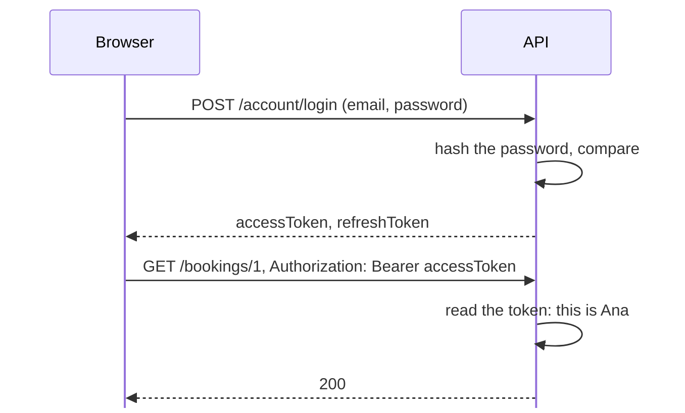
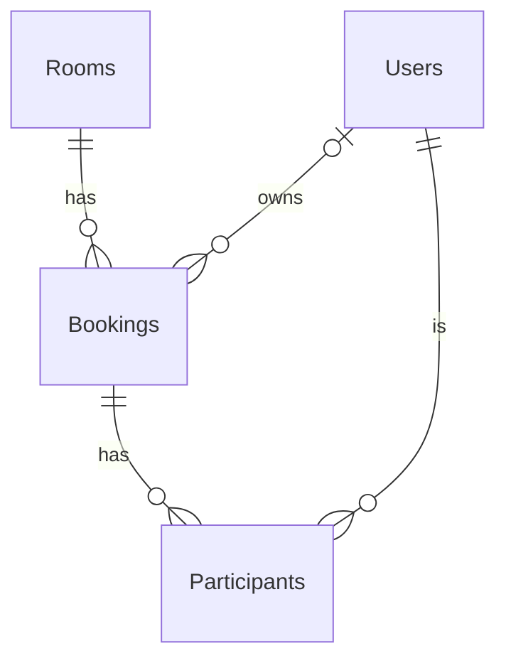
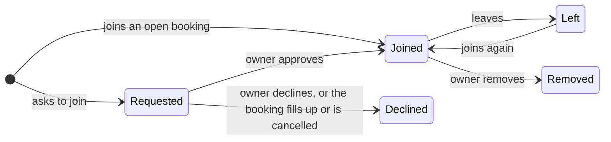

# Optional: Accounts, roles and the admin side

Optional and not graded. Feel free to leave.

---

# Where we left off

The bookings are in a database now, and two requests at once can no longer book a room twice. Three things are still missing:

- Anyone can send `"userId": "ana"` and act as Ana.
- An owner cannot approve the people who ask to join (R12).
- There is no admin who adds rooms or removes bookings (R1, R18).

Today: accounts with passwords, a user role and an admin role, join requests, and everything an admin does.

<AppLink tag="week-06" compare="week-05" />

<!--
The link shows every change since last week. It works once week-06 is tagged after the lab.
Students who keep last week's database can: the first run removes its users and bookings, and adds the sample accounts.
-->

---

# Two questions

| | The question | When the answer is no |
|---|---|---|
| Authentication | Who are you? | 401 Unauthorized |
| Authorization | Are you allowed to do this? | 403 Forbidden |

Every request answers the first question before the second. Without a token we do not know who is asking, so the answer is 401. A student who asks to add a room is known, and is still not allowed, so the answer is 403.

<!--
The name 401 Unauthorized is a historical mistake in HTTP: it means "unauthenticated". Students often mix the two up, so it is worth saying out loud.
-->

---

# Passwords are never stored

The database keeps a hash of each password: the result of a function that is easy to compute and impossible to reverse. At login the server hashes the password it receives and compares the two hashes.

```text
Users
  Email                      PasswordHash
  ana.popescu@example.com    AQAAAAIAAYagAAAAEJ3x...   (no way back to "Password1!")
```

If the database leaks, the passwords do not. Each hash also mixes in a random salt, so two students with the same password get different hashes.

<!--
PasswordHasher<AppUser> uses PBKDF2 with HMAC-SHA512 and 100,000 iterations: a hash made slow on purpose, so that guessing billions of passwords takes too long. The salt and the settings are stored inside the hash itself.
Open study-rooms.db and show the PasswordHash column.
-->

---

# An account

```cs
[Index(nameof(Email), IsUnique = true)]
public class AppUser
{
    public string Id { get; private set; }
    public string Email { get; private set; }
    public string DisplayName { get; private set; }
    public string PasswordHash { get; private set; } = "";
    public bool IsAdmin { get; private set; }
    ...
}
```

Last week's `User` gets two columns: the hash of the password, and whether the user is an admin. The unique index makes sure one email belongs to one account.

The class is called `AppUser` now, because every controller already has a property called `User`: what the token says about whoever sent the request.

---

# Signing up

```cs
public bool TryRegister(string email, string password, string displayName,
    [NotNullWhen(true)] out AppUser? user, out List<string> problems)
{
    // ... check the email, the length of the password, and that the email is free

    user = new AppUser(Guid.NewGuid().ToString(), email, displayName.Trim(), false);
    user.SetPasswordHash(_passwordHasher.HashPassword(user, password));
    _db.Users.Add(user);
    _db.SaveChanges();
    return true;
}
```

`PasswordHasher` comes with ASP.NET Core. `HashPassword` makes the hash with a new random salt, and the password itself is never stored. A new account gets a GUID as its id, a random number nobody can guess, such as `03595cf7-683e-4dd4-8b9c-2a4b7d5bea51`.

<!--
The real method stores emails in lowercase, so Ana@Example.com and ana@example.com are one account.
It also catches DbUpdateException around SaveChanges: two sign-ups with the same email at the same moment both pass the check, and the unique index refuses the second one. The race from week 5 again.
-->

---

# Checking a password

In `AccountService.CheckPassword(email, password)`:

```cs
AppUser? user = FindByEmail(email);
if (user is null)
{
    return null;
}
PasswordVerificationResult result =
    _passwordHasher.VerifyHashedPassword(user, user.PasswordHash, password);
if (result == PasswordVerificationResult.Failed)
{
    return null;
}
return user;
```

`VerifyHashedPassword` takes the salt from the stored hash, hashes the password it got in the same way, and compares. A wrong email and a wrong password both give `null`, and the same 401.

<!--
The same answer for both, so nobody can find out which emails have an account.
-->

---

# Logging in with a token



A token works like a festival wristband: you show your ID once at the entrance, then the wristband gets you in everywhere. The password travels once, at login. Every other request carries the token in the `Authorization` header.

---

# What is in a token

The token holds a few facts about the user, called claims: the id, the email, the display name and the role. The server encrypts them with a key that only it has, so nobody can read a token or change it into someone else's.

The access token lasts one hour. The refresh token lasts 14 days, and `POST /account/refresh` trades it for a new access token, so the interface does not have to ask for the password every hour.

Whoever holds a token can act as its owner until it expires. Keep it as private as the password.

<!--
These are not JWTs. ASP.NET Core protects them with its Data Protection keys, which on our laptops live in ~/.aspnet/DataProtection-Keys, so tokens survive a restart of the API.
JWT is the format to use when another service must check the token without asking our API; it would come up with a separate login server.
Refresh reads the account again, so a new display name or a new role shows up in the next access token.
-->

---

# The claims

```cs
private IActionResult SignInWithToken(AppUser user)
{
    List<Claim> claims =
    [
        new Claim(ClaimTypes.NameIdentifier, user.Id),
        new Claim(ClaimTypes.Email, user.Email),
        new Claim(ClaimTypes.Name, user.DisplayName),
        new Claim(ClaimTypes.Role, role),    // "Admin" or "Student"
    ];
    ClaimsIdentity identity =
        new ClaimsIdentity(claims, BearerTokenDefaults.AuthenticationScheme);
    return SignIn(new ClaimsPrincipal(identity),
        BearerTokenDefaults.AuthenticationScheme);
}
```

`SignIn` encrypts the claims into the two tokens and writes them into the answer. `Login` and `Refresh` both end here.

<!--
role is Roles.Admin when user.IsAdmin, and Roles.Student otherwise (an if in the real code).
A ClaimsPrincipal is the user as ASP.NET Core sees it: a set of claims. In a controller, User is exactly this object, read back from the token.
-->

---

# Registering authentication

```cs
builder.Services.AddSingleton<PasswordHasher<AppUser>>();

builder.Services.AddAuthentication(BearerTokenDefaults.AuthenticationScheme)
    .AddBearerToken();
builder.Services.AddAuthorization();
```

```cs
app.UseAuthentication();    // who is this? reads the token
app.UseAuthorization();     // are they allowed? checks [Authorize]
app.MapControllers();
```

Authentication reads the token of every request and fills in `User`. Authorization then checks `[Authorize]`. The order matters: first find out who it is, then decide.

<!--
PasswordHasher keeps no state, so one object for the whole application is enough: a singleton, as in last week's lifetimes table.
AccountService is scoped, like the other services, because it uses the AppDbContext.
-->

---

# Who is asking

```cs
public abstract class AppControllerBase : ControllerBase
{
    protected string CurrentUserId => User.FindFirstValue(ClaimTypes.NameIdentifier)
        ?? throw new InvalidOperationException(...);
}
```

`User` is what authentication read from the token. Our controllers inherit from this class, so each of them can use `CurrentUserId`. The request bodies lose their `userId`:

```cs
public record BookingRequest(
    int RoomId, DateOnly Date, TimeOnly Start, TimeOnly End, JoinPolicy JoinPolicy);
```

<!--
The abstract base class is lab 4 again: nobody creates an AppControllerBase, it only exists to be inherited.
The ownership checks from week 4 stay exactly as they were. if (CurrentUserId != booking.OwnerId) return 403. The only difference is where the id comes from.
-->

---

# `[Authorize]`

```cs
[ApiController]
[Route("bookings")]
[Authorize]
public class BookingsController : AppControllerBase
```

```cs
[ApiController]
[Route("admin/rooms")]
[Authorize(Roles = Roles.Admin)]
public class AdminRoomsController : AppControllerBase
```

`[Authorize]` needs a logged-in user, or the answer is 401 before our code runs. With a role, it also needs that role, or the answer is 403. `AccountController` has no `[Authorize]`: nobody has a token before they log in.

<!--
Roles.Admin is a const string "Admin" in a static class, so a typo becomes a compile error instead of a 403 that is hard to explain.
In Program.cs: app.UseAuthentication() and app.UseAuthorization() before app.MapControllers(). Order matters: first find out who it is, then decide.
-->

---

# What we left out

Many projects use ASP.NET Core Identity, a library that handles accounts. Besides hashing passwords, it locks an account after too many wrong passwords, confirms emails, resets forgotten passwords and supports two-factor login.

It also brings seven tables, and its user table has sixteen columns. We need five of them, so we take only its password hasher and write the rest ourselves, in `AccountService` and `AccountController`.

For your own project, Identity is a good choice if you need password reset or email confirmation.

<!--
The tables: AspNetUsers, AspNetRoles, AspNetUserRoles, AspNetUserClaims, AspNetRoleClaims, AspNetUserLogins, AspNetUserTokens.
Its UserManager methods are all asynchronous, which is one more reason to skip it before week 9.
Sign-in with GitHub or Google in week 11 works without Identity too: one more column on AppUser.
-->

---

# Sample accounts

| Email | Role | Id |
|---|---|---|
| `admin@example.com` | admin | `admin` |
| `ana.popescu@example.com` | student | `ana` |
| `mihai.ionescu@example.com` | student | `mihai` |

All of them have the password `Password1!`. The API creates them at startup, only on our own computers (the Development environment), and only when there are no accounts yet.

A new account gets a GUID as its id. The sample ones have short ids so the `.http` file can name them.

<!--
Also ioana and radu, students. Roles are created at every startup if they are missing, in every environment, since the API needs them.
-->

---

# Trying it with a token

In Scalar, paste the `accessToken` in the Bearer field at the top of the page, and every request sends it.

In the `.http` file, paste each token once:

```text
@ana = CfDJ8Ka9_5hxaLZKv5hlDF2U23bQ1SI1pDW3xScnvHGJua9...
```

```http
POST {{host}}/bookings/1/join
Authorization: Bearer {{mihai}}
```

<!--
Send the four logins at the top of StudyRooms.Api.http and paste the tokens after @ana, @mihai, @radu and @admin. Tokens last an hour, so log in again if a request suddenly answers 401.
-->

---
layout: two-cols
---

# Relationships



::right::

<div class="pl-6 pt-22">

A booking belongs to one room, and a room has many bookings. Each of these lines is a foreign key: a column such as `Bookings.RoomId` that must hold the id of an existing row in `Rooms`. The database refuses anything else.

A block has no owner, so `OwnerId` may be empty. That is the line with a circle at the user's end.

</div>

<!--
Read the line ends: || is exactly one, o{ is zero or more, |o is zero or one.
Last week only Participants had a foreign key (to Bookings). The migration this week adds the three others.
Last week's users have no password, so nobody could log in as them. We edited the migration by hand to delete them and their bookings first, and the API creates the sample accounts again: a migration is C# that we may change.
-->

---

# Navigation properties

```cs
public class Booking
{
    public int RoomId { get; private set; }
    public Room Room { get; private set; } = null!;

    public string? OwnerId { get; private set; }    // null for a block
    public AppUser? Owner { get; private set; }
    ...
}
```

Next to the id, the class gets the object itself. EF Core sees the pair `RoomId` and `Room` and knows they describe the same foreign key. `booking.Room.Capacity` replaces the lookup by id from week 5.

`= null!` tells the compiler that the room will not stay null: EF Core fills it in when the query asks for it.

<!--
Participant gets the same: UserId and User. The constructors take the objects now: new Booking(room, owner, ...), new Participant(user, status).
The private constructors for EF Core stay, as in week 5.
-->

---

# `Include` and `ThenInclude`

```cs
private IQueryable<Booking> BookingsWithDetails()
{
    return _db.Bookings
        .Include(b => b.Room)
        .Include(b => b.Owner)
        .Include(b => b.Participants.OrderBy(p => p.CreatedAt))
        .ThenInclude(p => p.User);
}
```

EF Core loads a navigation property only when the query asks for it. `Include` adds the room and the owner, and `ThenInclude` goes one step further, from each participant to their account. It all comes back in one query, with SQL joins.

`IQueryable` is a query not sent yet. The callers add their own `Where` and `OrderBy`, and `ToList()` sends it.

<!--
Without the Include, booking.Room stays null and the first booking.Room.Name throws a NullReferenceException. Try it live by removing one Include.
Show the SQL in the log: LEFT JOIN Rooms, LEFT JOIN Users.
-->

---

# Joining on request



`POST /bookings/1/join` joins an open booking at once. On a booking with the "on request" policy it only asks, and the owner sees the request in the booking's `requests`.

<!--
Each box is a value of ParticipantStatus, which has existed since week 3. This week every arrow has code behind it.
-->

---

# Approving a request

The owner calls `POST /bookings/1/participants/mihai/approve`. The service then checks, in one transaction:

1. the caller is the owner, or the answer is 403;
2. Mihai is not in another booking at that time, since a pending request does not count as being somewhere;
3. the booking is not full.

Then Mihai is in. His other requests for the same time are declined, because he cannot be in two places at once. If the booking is now full, everyone still waiting is declined too.

<!--
The transaction is for the same reason as last week's TryJoin: two approvals for the last place must not both pass the check.
Each automatic decline writes a log line "notify them". In week 9 those lines become real notifications.
-->

---

# Who sees what

| | Other students | The owner | An admin |
|---|---|---|---|
| Display names of the people in it | yes | yes | yes |
| Who is waiting for approval | no | yes | yes |
| Emails, and every participant's status | no | no | yes |

Students get a `BookingResponse`, and only the owner's has `requests` filled in. Admins get an `AdminBookingResponse`. Each person comes with an id, such as `mihai`, so that the owner can approve or remove them. The id says nothing about the person.

<!--
This is R7 from week 2. Week 4 started it with response records; now that we know who is asking, the response can depend on it.
MyStatus in BookingResponse tells the student where they stand: Joined, Requested, Declined, or null. The interface in week 8 uses it to choose the button: Join, Requested, or Leave.
-->

---

# The admin and the rooms

| Request | What it does |
|---|---|
| `POST /admin/rooms` | adds a room |
| `PUT /admin/rooms/1` | changes every detail of a room |
| `DELETE /admin/rooms/1` | hides the room and cancels its future bookings |

A removed room stays in the database, so old bookings can still show it, and `GET /rooms` leaves it out. Lowering the capacity is allowed: a booking keeps its people, and nobody new joins until it fits (R3).

Two rooms with the same name: the unique index from week 5 refuses the save with an exception, and we answer 409.

<!--
try/catch from lab 3: RoomService.TrySave catches DbUpdateException.
Removing a room writes "notify" log lines for every cancelled booking (R2, R16).
-->

---

# The admin and the bookings

`GET /admin/bookings?date=...` shows every booking that day, cancelled ones too. `POST /admin/bookings/1/cancel` cancels any booking, even after the owner's 2 hour cutoff.

An admin can also book for a student, more than 7 days ahead, and block a room for a class:

```cs
public Booking(Room room, DateOnly date, TimeOnly start, TimeOnly end, string note)
    : this(room, date, start, end)
{
    Note = note;
    JoinPolicy = JoinPolicy.Private;
}
```

A block has no owner and nobody in it. `: this(...)` runs the constructor the two kinds of booking share first, the way `: base(...)` runs the parent's constructor.

<!--
An admin booking for a student skips the 7 day limit but never the room overlap, the student's overlap or the capacity: BookingRules has CheckTimes for students and CheckTimesForAdmin.
A block over an existing booking is refused with 409; the admin cancels that booking first.
-->

---

# CORS

A page on `razvangolan.github.io` that calls our API is a request from one site to another. The browser allows that only if the API agrees: before the real request, it asks the API which sites may call it.

```cs
builder.Services.AddCors(options => options.AddDefaultPolicy(policy =>
    policy.WithOrigins(origins).AllowAnyHeader().AllowAnyMethod()));
```

```json
"Cors": { "Origins": [ "https://razvangolan.github.io", "http://localhost:5173" ] }
```

The interface in week 8 runs on those two addresses. Nothing to see until then.

<!--
The question the browser sends first is an OPTIONS request, called a preflight. Show it with curl:
curl -i -X OPTIONS http://localhost:5080/rooms -H "Origin: http://localhost:5173" -H "Access-Control-Request-Method: GET" -H "Access-Control-Request-Headers: authorization"
The answer has Access-Control-Allow-Origin. With Origin: https://evil.example it does not, and the browser would block the call.
CORS protects users in a browser. curl and the .http file ignore it, which is why they worked all along.
-->

---

# Trying it out

```text
GET  /rooms without a token                       401
POST login as ana, mihai, radu, admin             200  tokens
POST ana books A101, on request                   201
POST mihai and radu ask to join                   200  Requested
POST radu approves mihai                          403  only the owner
POST ana approves mihai                           200
POST radu books B204 at 10:00, ana approves radu  409  he is busy then
POST ana adds a room                              403  not an admin
POST admin blocks A102 for a class                201
DELETE admin removes A101                         204  ana's booking: RoomRemoved
```

<!--
SHOWCASE: delete study-rooms.db, start the API, log in four times and paste the tokens, then send StudyRooms.Api.http from top to bottom. Every request has its expected status in its comment.
-->

---

# What is still missing

- Every "notify them" is still a log line, and nobody gets reminded before a booking (R15 to R17).
- There is no interface: all of this happens in Scalar and the `.http` file.

Next week is Test 1, with no optional part. In week 8 the timetable comes to the browser, with a login form and the token kept by the page.

<AppLink tag="week-06" compare="week-05" />
