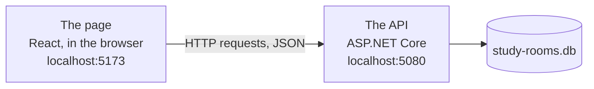
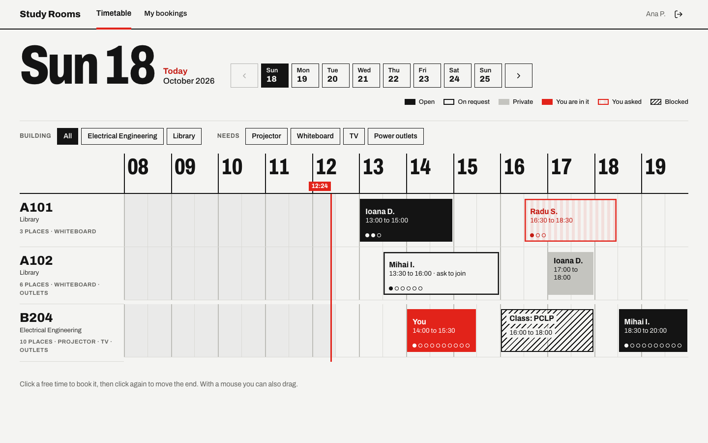
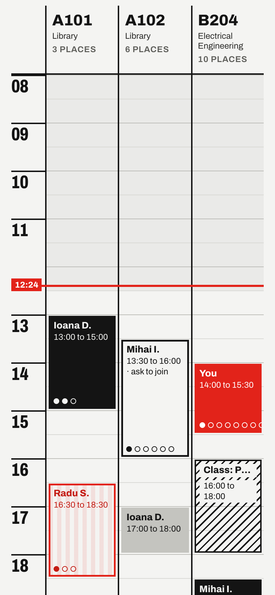
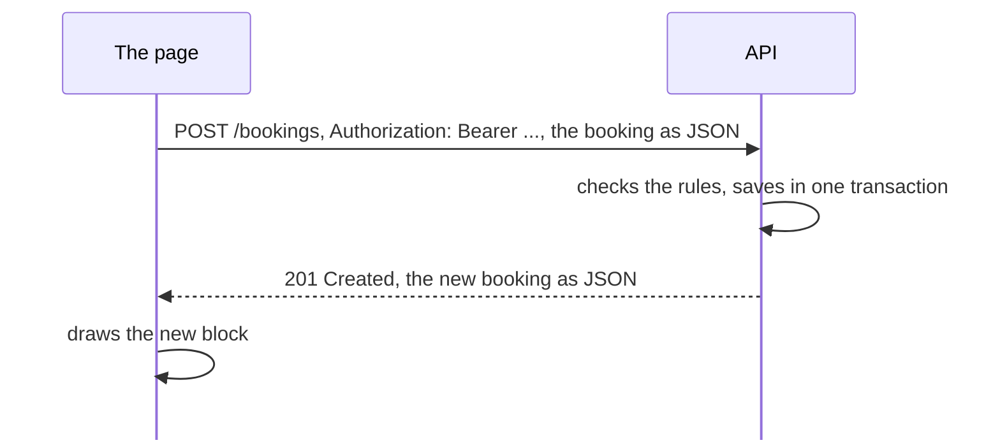

# Optional: The timetable in the browser

There is no graded lab this week, only this optional part. Feel free to leave.

---

# Where we left off

After week 6 the API has accounts, roles, join requests and an admin side. So far we have only used it from Scalar and the `.http` file.

This week it gets a web page. We do not write the page in class: it is ready in the `frontend` folder of the repository, and we use it to watch our API at work.

<AppLink tag="week-08" compare="week-06" />

<!--
The compare link works once week-08 is tagged after the session. There is no week-07 tag, because week 7 was Test 1.
Since week 6 the API also changed a little: booking a room withdraws your own join requests at the same time (R13), and the refusals say "You are already in a booking in A101 from 15:00 to 16:30." instead of naming the student or a booking id.
-->

---

# Two programs



The browser downloads the page once: HTML, CSS and JavaScript. After that, every click that needs data becomes an HTTP request to the API, and the answer is the same JSON we saw in Scalar.

<!--
The page is a separate program with its own address. In production it is on GitHub Pages and the API is on a server, two different sites. That is why CORS shows up later in this deck.
React and Vite are only the tools the page is written with. We do not need to know them to follow the requests.
-->

---

# Running it

Two terminals, both in the `study-rooms` folder:

```bash
dotnet run --project src/StudyRooms.Api
```

```bash
cd frontend
npm install
npm run dev
```

Open http://localhost:5173 and click one of the sample accounts on the login page. The page needs Node.js 20 or newer, on your own computer.

<!--
npm install runs once. It downloads React and the other packages into frontend/node_modules.
npm run dev starts Vite, a small server for the page that reloads it when a file changes.
The API must run too: the page shows "The API is not reachable" when it is not.
-->

---
layout: center
---



<!--
Rooms down the left, hours across the top. Click a free time to book it, click a booking to see who is in it and to join it. Black is open, outlined is on request, grey is private, red is yours, hatched is a block from an admin.
The filters above the grid: the building is filtered in the page, the equipment with GET /rooms?equipment=Projector.
-->

---
layout: two-cols
---

# On a phone

The same page turns on its side: hours run down the screen and each room is a column, so there is no sideways scrolling.

The page reads the width of the window and picks the layout. The API does not know, and answers the same requests either way.

::right::



<!--
Show it live: open the developer tools, toggle the device toolbar (Ctrl+Shift+M, or Cmd+Shift+M on a Mac) and pick a phone.
In week 11 the class opens the page on their own phones.
-->

---

# One click, one request



The page sends the same request as the one in our `.http` file, with the token it got at login.

<!--
When the API refuses, the page shows the problems from the ErrorResponse as they are. Every message on screen comes from our C# code.
-->

---

# Watching the requests

Every browser has developer tools. Open them with F12, or Cmd+Option+I on a Mac, go to the Network tab and pick Fetch/XHR, so only the calls to the API are left.

Click a request to see it:

| Tab | What it shows |
|---|---|
| Headers | the method, the URL, the status code, and the `Authorization` header |
| Payload | the JSON the page sent |
| Response | the JSON the API answered |

<!--
In Firefox the tabs are Headers, Request and Response.
Turn on "Preserve log" so the list survives a reload.
Right click a request, Copy, Copy as cURL: the same request, ready for the terminal.
-->

---

# Things to try

| In the page | The request | The answer |
|---|---|---|
| Pick a day | `GET /timetable?date=...` | 200, the bookings of that day |
| Book a free time | `POST /bookings` | 201, the new booking |
| Book a time when you are busy | `POST /bookings` | 409, "You are already in a booking..." |
| Join a full booking | `POST /bookings/7/join` | 409, "The booking is full." |

<!--
Logging in is POST /account/login, and its answer has the two tokens.
SHOWCASE: log in as ana in a normal window and as mihai in a private window. Ana books an open booking, Mihai joins it, Ana sees him in her booking. Keep the Network tab open in both.
As a student, open #/admin: the page shows the timetable instead. Hiding the admin pages is only for comfort. Paste a student token in Scalar and call POST /admin/rooms: 403. The API decides, never the page.
-->

---

# Two students at once

Open the page in a normal window and in a private window, and log in as two different students. A booking made in one shows up in the other within 15 seconds.

The page asks for the timetable again every 15 seconds, and when you come back to its window. Each of those is a `GET /timetable` in the Network tab.

<!--
A private window has its own storage, so the two logins do not mix.
Asking again on a timer is called polling. The server could also push changes to the page, but that needs a connection that stays open, and we do not need it here.
-->

---

# CORS in the browser

The page on `localhost:5173` calls the API on `localhost:5080`, another origin. Before each call the browser asks the API whether this page may call it: an `OPTIONS` request, right before the real one in the Network tab.

Take `http://localhost:5173` out of `Cors:Origins` in `appsettings.json`, restart the API, and the page stops working. The browser blocks the answer, and the reason is in the Console tab.

<!--
This is the CORS setup from week 6, now with a real page. Put the origin back and restart.
The preflight happens here because the requests carry an Authorization header and a JSON body. Simple requests skip it.
CORS protects people using a browser. curl and the .http file are not limited by it, and Scalar runs on the API's own address, so it never needs to ask.
-->

---

# Where the token lives

In the Application tab (Storage in Firefox), Local Storage for `localhost:5173` has `study-rooms.tokens`: the access token, the refresh token and when the access token runs out. The page copies the access token into the `Authorization` header of every request, and asks `/account/refresh` for a new one after an hour.

Any script on the page can read local storage, so a bug that lets someone run their own script on our page (an XSS bug) would leak the token. A cookie marked `HttpOnly` cannot be read by scripts, but it needs the page and the API on the same site, and ours are on two.

<!--
Delete study-rooms.tokens and reload: the page shows the login form again.
Paste the access token into jwt.io: it is not a JWT. AddBearerToken makes an encrypted token that only our API can read.
-->

---

# Next week

Every "notify them" in the logs becomes a real notification: a reminder before a booking starts, and an inbox in the page for joins, requests and cancellations.

<AppLink tag="week-08" />
