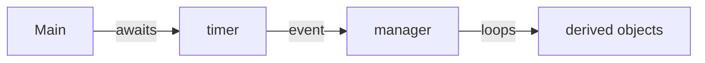

# Lab 11: Test 2 recap

Methods that take a `Func`, LINQ one-liners, and a program where a class hierarchy, an event and an async loop work together

---

# Test 2

Next week's test has three parts, in this order:

1. a method that takes a `Func`, written by hand with a loop
2. a few LINQ one-liners
3. a longer program: an abstract class with derived classes, a class that keeps a list of them, and a timer class that raises an event from an async `StartAsync`, all wired together in `Main`

The third part is worth the most.

Today we go through each part with a checklist. Then you practise on a problem with the same shape, without looking at earlier labs.

<!--
2025 points: 1p for the Func method, 2p for the LINQ lines, 6p for the program, 1p free.
-->

---
layout: two-cols
---

# Taking a `Func`

```cs
int IndexWhere<T>(List<T> items,
                  Func<T, bool> test)
{
    for (int i = 0; i < items.Count; i++)
    {
        if (test(items[i]))
        {
            return i;
        }
    }
    return -1;
}
```

```cs
IndexWhere(songs, s => s.Year > 2000);
```

::right::

<div class="pl-6 pt-22">

Check:

- `<T>` after the name
- the loop calls `test(item)` on each item
- the result is returned after the loop, or as soon as it is known
- you write the loop, without LINQ

Lab 5 has `CountWhere` and `TotalOf`.

</div>

<!--
IndexWhere returns the index of the first item that passes, or -1, like List.FindIndex.
-->

---

# Reading a `Func` type

| Type | Takes | Returns |
|---|---|---|
| `Func<int, bool>` | an `int` | a `bool` |
| `Func<Song, string>` | a `Song` | a `string` |
| `Func<int, int, int>` | two `int`s | an `int` |
| `Action<string>` | a `string` | nothing |

The last type in a `Func` is what it returns. An `Action` returns nothing.

A method that returns a new list creates it before the loop with `List<T> result = [];`, adds to it inside, and returns it at the end.

---
layout: two-cols
---

# LINQ one-liners

```cs
songs.Count(s => s.Genre == "rock")

songs.OrderBy(s => s.Year).First().Title

songs.Where(s => s.Year > 2000)
     .Select(s => s.Title)
     .ToList()

songs.Average(s => s.Seconds)

songs.GroupBy(s => s.Genre).Count()
```

::right::

<div class="pl-6 pt-22">

Check:

- one step for each part of the question
- `Where` keeps items, `Select` changes them
- end with what is asked: a number, one item, or `ToList()`
- `First` throws when nothing matches

See lab 10.

</div>

<!--
The songs are the ones from lab 10's Charts project.
Count() is a LINQ method; Count without parentheses is the property of a List.
-->

---

# The longer program



`Main` subscribes the manager to the timer's event and awaits `StartAsync`. On every tick the manager loops over its `List<Base>`. The timer knows nothing about the manager, and the manager knows nothing about the derived classes.

We built every piece already: the hierarchy and a manager class in lab 4, events in lab 6, the async loop in lab 9.

---
layout: two-cols
---

# The manager class

```cs
public class Catalog
{
    private readonly List<Media> items = [];

    public void Add(Media item)
    {
        items.Add(item);
    }

    public int TotalMinutes()
    {
        int total = 0;
        foreach (Media item in items)
        {
            total += item.Minutes;
        }
        return total;
    }
}
```

::right::

<div class="pl-6 pt-22">

Check:

- the base class is `abstract`, and the derived classes `override` its members and `ToString`
- a private `List<Base>`, filled through a method
- loops with no casts and no `is`

Lab 4 has the full example.

</div>

---
layout: two-cols
---

# The timer class

```cs
public class Metronome
{
    public event Action<int>? Beat;
    public event Action? Stopped;
    // Tempo and the constructor

    public async Task StartAsync(
        CancellationToken token)
    {
        int count = 0;
        while (!token.IsCancellationRequested)
        {
            count++;
            Beat?.Invoke(count);
            await Task.Delay(60000 / Tempo);
        }
        Stopped?.Invoke();
    }
}
```

::right::

<div class="pl-6 pt-22">

Check:

- `Action<int>` means subscribers take an `int`
- `async Task`, never `async void`
- `await Task.Delay`, never `Thread.Sleep`
- raise the event with `?.Invoke(...)`

Lab 9 has the full example.

</div>

---

# Wiring it up in `Main`

```cs
Metronome metronome = new Metronome(120);

BarCounter counter = new BarCounter(4);
metronome.Beat += counter.OnBeat;

CancellationTokenSource source = new CancellationTokenSource();
source.CancelAfter(TimeSpan.FromSeconds(3));
await metronome.StartAsync(source.Token);
Console.WriteLine($"{counter.Bars} bars");
```

Check:

- create the objects first, and fill the manager's list
- subscribe the manager's method with `+=`, without parentheses after its name
- `await` the call to `StartAsync`, or the program ends before the first tick
- a classic `Main` has to be `static async Task Main()`

<!--
This is lab 9's Rhythm project with CancelAfter instead of Enter. BarCounter.OnBeat plays the manager's part.
-->

---

# Easy mistakes

| What you see | Why |
|---|---|
| the program ends before the first tick | `StartAsync` was not awaited |
| nothing happens on a tick | the subscription is missing, or comes after the await |
| error CS0104 on `Timer` | .NET has a `Timer` class too, so pick another name |
| a cast in the manager's loop | the member is missing from the base class |

<!--
CS0104: with ImplicitUsings, Program.cs sees both System.Threading.Timer and your Timer. Calling it GameTimer, Clock or Ticker avoids it. Inside your own namespace the error does not appear, which is why it surprises people.
-->

---

# Practice: the first two parts

Start with `dotnet new console -n Parking`, and do not look at earlier labs.

1. `Dictionary<string, int> CountBy<T>(List<T> items, Func<T, string> key)` counts how many items have each key. Call it on a list of words with their first letter as the key, then on a list of numbers with `"even"` or `"odd"`.
2. For `List<int> minutes = [35, 120, 15, 240, 60, 70];`, the minutes some cars stayed in a car park, write one line for each:
    - the stays longer than an hour, longest first
    - the total time in hours
    - whether any stay was shorter than 20 minutes
    - each stay as a text such as `"35 min"`

<!--
About 15 minutes for both. CountBy uses TryGetValue from lab 5.
Expected for part 2: 240, 120, 70 / 9 / True / 35 min, 120 min, ...
-->

---

# Practice: the program

3. An abstract class `Vehicle` with a `Plate`, an abstract `PricePerHour` and a `Bill` that starts at 0. A method `Charge()` adds one hour's price to the bill. `Car` costs 5 lei an hour and `Motorbike` 2 lei. Both override `ToString`.

    A class `Garage` keeps a `List<Vehicle>`. `Park` adds a vehicle, and `OnHour(int hour)` charges every vehicle and prints it.

    A class `Clock` has an event `Action<int>? Hour` and a method `async Task StartAsync(int hours)` that raises `Hour` once every half second, `hours` times.

    In `Main`, park two cars and a motorbike, subscribe the garage to the clock, run it for 3 hours, then print the total of all bills.

<!--
About 30 minutes. Walk around and check the lists from the earlier slides.
Expected: after hour 3 the cars owe 15 lei each, the motorbike 6 lei, total 36 lei.
-->
